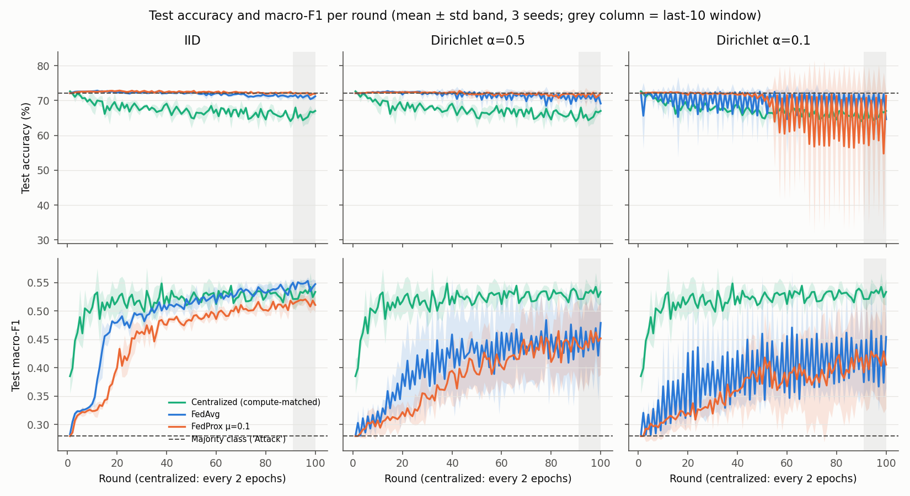
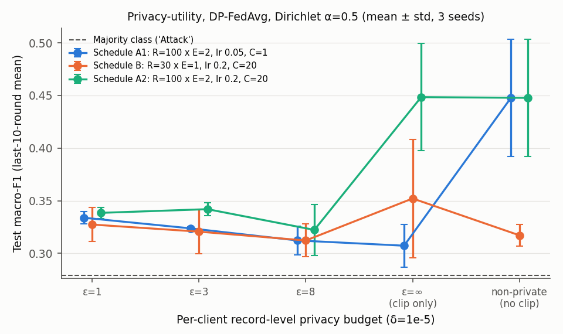
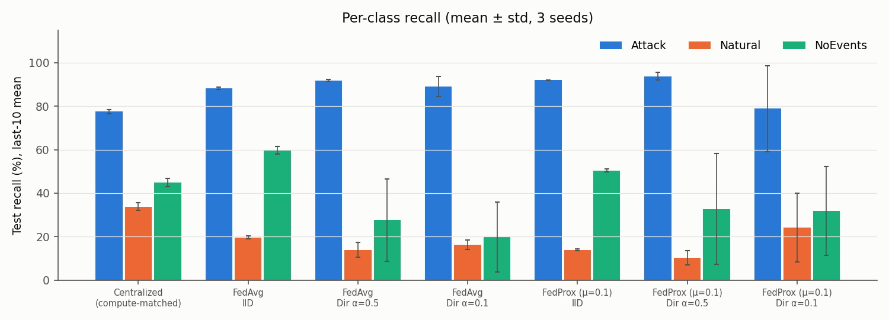

# fedpriv-bench: federated and differentially private attack detection on power-system data, done carefully

A small, reproducible study of federated learning (FedAvg, FedProx) and client-side
differential privacy (DP-SGD via Opacus) for classifying power-system events as
**Attack / Natural fault / No event**, with a leakage-safe split, a compute-matched centralized
baseline, non-IID clients, 3 seeds per configuration and metrics that cannot be cherry-picked.

## Motivation

In a 2025 summer internship I hand-implemented FedAvg with a 1D CNN on smart-grid attack
telemetry and reported 99.3% accuracy / 0.95 macro-F1 for FL versus 97.4% / 0.81 for a
centralized model. Re-reading that work, the comparison does not hold up: the FL model got about
12x more training (50 rounds x 5 local epochs over all clients, roughly 250 epoch-equivalents,
versus 20 centralized epochs); the two models were tested on different random splits; overlapping
sliding windows were split at random, so near-identical windows sat on both sides of the split
(and the scaler was fit before splitting); the 5 clients were IID; and the headline was the
final-round value of a noisy curve. That dataset is not public, so this repo redoes the
question on a public power-system attack dataset and fixes each of those flaws. The result is
less flattering and more useful (see Findings).

## Results at a glance

Test set = scenario-set files 13-15 (15,662 rows), never used for any decision. Mean ± sample std
over 3 seeds. "Last-10" = mean over the last 10 rounds. Accuracy and recall in %. Full tables,
including validation and early-stopping views, are in [`results/summary.md`](results/summary.md),
generated by `scripts/make_report.py` from the run files.

### Centralized (compute-matched) vs FedAvg vs FedProx, K = 10 clients

| Setting | Acc final | Acc last-10 | Macro-F1 final | Macro-F1 last-10 | Recall Attack | Recall Natural | Recall NoEvents |
|---|---|---|---|---|---|---|---|
| Centralized (compute-matched) | 67.0 ± 1.0 | 65.9 ± 0.4 | 0.534 ± 0.023 | 0.530 ± 0.001 | 77.5 ± 0.9 | 33.8 ± 1.8 | 45.0 ± 1.9 |
| FedAvg, IID | 71.2 ± 0.9 | 71.1 ± 0.3 | 0.547 ± 0.007 | 0.546 ± 0.003 | 88.2 ± 0.6 | 19.6 ± 0.7 | 59.8 ± 1.7 |
| FedAvg, Dir α=0.5 | 69.1 ± 3.5 | 70.8 ± 0.9 | 0.479 ± 0.054 | 0.448 ± 0.056 | 91.9 ± 0.5 | 14.0 ± 3.3 | 27.6 ± 18.9 |
| FedAvg, Dir α=0.1 | 64.6 ± 7.1 | 69.0 ± 2.2 | 0.454 ± 0.090 | 0.414 ± 0.054 | 89.1 ± 4.6 | 16.4 ± 2.2 | 19.8 ± 16.2 |
| FedProx (μ=0.1), IID | 72.0 ± 0.4 | 72.0 ± 0.0 | 0.511 ± 0.013 | 0.516 ± 0.004 | 91.9 ± 0.1 | 13.9 ± 0.4 | 50.5 ± 0.7 |
| FedProx (μ=0.1), Dir α=0.5 | 72.1 ± 0.5 | 71.7 ± 0.9 | 0.452 ± 0.064 | 0.446 ± 0.062 | 93.8 ± 1.7 | 10.4 ± 3.3 | 32.8 ± 25.5 |
| FedProx (μ=0.1), Dir α=0.1 | 71.4 ± 0.9 | 64.0 ± 10.4 | 0.405 ± 0.077 | 0.413 ± 0.072 | 78.9 ± 19.8 | 24.2 ± 15.8 | 31.9 ± 20.4 |
| Majority class (always "Attack") | 72.1 | 72.1 | 0.279 | 0.279 | 100.0 | 0.0 | 0.0 |

Recall columns are last-10 means. Every run in this table processed exactly 10,448,000
sample-gradients. At the validation-selected round (early stopping on validation macro-F1), test
macro-F1 is 0.540 ± 0.005 centralized vs 0.545 ± 0.016 FedAvg IID, 0.466 ± 0.057 at α=0.5 and
0.461 ± 0.072 at α=0.1.

### Privacy-utility: DP-FedAvg, Dir α=0.5, δ = 1e-5 (test macro-F1, last-10 mean)

ε is the record-level budget each client spends on its own data, read back from the per-client
RDP accountant; the achieved worst-client ε was within 0.003 of every target.

| Target ε | A1: lr 0.05, C=1 | A2: lr 0.2, C=20 | B: 30 rounds, lr 0.2, C=20 | σ range over clients (A1/A2) |
|---|---|---|---|---|
| 1 | 0.334 ± 0.006 | 0.338 ± 0.005 | 0.327 ± 0.016 | 5.86-57.50 |
| 3 | 0.324 ± 0.001 | 0.342 ± 0.006 | 0.321 ± 0.021 | 2.27-21.17 |
| 8 | 0.312 ± 0.014 | 0.322 ± 0.024 | 0.312 ± 0.016 | 1.14-9.02 |
| ∞ (clipping only, σ=0) | 0.307 ± 0.020 | 0.448 ± 0.051 | 0.352 ± 0.056 | 0 |
| non-private FedAvg (no clipping) | 0.448 ± 0.056 | 0.448 ± 0.056 | 0.317 ± 0.010 | - |
| majority class | 0.279 | 0.279 | 0.279 | - |

Schedules A1 and A2 use the main-grid schedule (R=100, E=2); B uses R=30, E=1. Per-class recall,
accuracy and final-round values for each block are in `results/summary.md`. For example, NoEvents
recall (last-10) under A2 is 28.5 ± 17.6% with clipping only and 6.0-9.2% for ε ∈ {1, 3, 8}.

### Leakage check: same data and models, only the split changes (centralized, 3 seeds)

| Model | Split | Test acc | Test macro-F1 |
|---|---|---|---|
| MLP (last-10 epochs of 40) | by scenario set (train 1-12, test 13-15) | 69.3 ± 0.3 | 0.516 ± 0.005 |
| MLP (last-10 epochs of 40) | random 20% of rows | 75.4 ± 0.1 | 0.640 ± 0.005 |
| RandomForest, 200 trees | by scenario set (train 1-12, test 13-15) | 71.8 ± 0.1 | 0.602 ± 0.001 |
| RandomForest, 200 trees | random 20% of rows | 92.5 ± 0.1 | 0.916 ± 0.004 |

### Figures







## Findings

1. **The split matters more than the algorithm.** Splitting random rows instead of scenario sets
   raises RandomForest accuracy from 71.8% to 92.5% and macro-F1 from 0.602 to 0.916 on the same
   data. Rows from the same simulated event are near-duplicates, so a random split measures
   memorisation. The internship's random split of overlapping windows had the same exposure.
2. **On an honest split this task is hard, and accuracy hides it.** Attack is 72.1% of the test
   set, and no model beats that accuracy. Macro-F1 separates them: 0.41-0.55 for the MLP models
   against 0.279 for always predicting "Attack". By accuracy alone the centralized model looks
   worst (65.9%); by macro-F1 it is among the best, because it trades Attack recall for the
   highest Natural recall (33.8%).
3. **At equal compute, IID FedAvg matches centralized training; it does not beat it.** Last-10
   macro-F1 is 0.546 ± 0.003 vs 0.530 ± 0.001, and at the validation-selected round it is
   0.545 ± 0.016 vs 0.540 ± 0.005. The internship's FL-over-centralized gap is better explained by
   12x more training and leakage than by federation.
4. **Label skew costs utility and stability, mostly on the rare classes.** FedAvg macro-F1 falls
   from 0.546 (IID) to 0.448 (α=0.5) and 0.414 (α=0.1). The seed-to-seed std grows from 0.003 to
   about 0.055, and NoEvents recall drops from 59.8% to 27.6 ± 18.9% and 19.8 ± 16.2%. At α=0.1
   the global model oscillates from round to round (Figure 1), so a single final-round number is
   unreliable. FedProx at α=0.1 shows 71.4 ± 0.9% accuracy at the final round but
   64.0 ± 10.4% over the last 10 rounds.
5. **FedProx did not help here.** μ=0.1 won the validation sweep (0.462 vs 0.302-0.387 for other μ,
   one tuning seed). On test with 3 seeds it is level with FedAvg at α=0.5 (0.446 vs 0.448) and
   α=0.1 (0.413 vs 0.414) and worse under IID (0.516 vs 0.546). The single-seed tuning gain did not
   replicate.
6. **Clipping at C=1 alone collapses the model to the majority class, and it hits the rare classes
   first.** With the main-grid hyper-parameters, clipping without any noise (ε=∞) gives 0.307 macro-F1
   and 0.3% NoEvents recall (non-private: 0.448 and 27.6%). The diagnostic in
   `results/summary.md` shows why. After 2 epochs of ordinary training the median per-sample gradient norm is
   2.30 for Attack but 5.66 for Natural and 16.04 for NoEvents, so clipping at C=1 scales
   minority-class gradients by about 0.11-0.18 and majority-class gradients by 0.46. This is
   the known disparate impact of DP-SGD on under-represented groups, seen directly here.
7. **With a larger clip norm, clipping is harmless and the cost comes from the noise.** With lr 0.2
   and C=20 (selected on validation), clipping-only matches the non-private model (0.448 vs 0.448).
   Adding the noise needed for ε ∈ {1, 3, 8} drops macro-F1 to 0.32-0.34 and NoEvents recall to 6-9%.
   That leaves most models only about 0.04-0.06 above the majority baseline. With 3 seeds, ε=1,
   3 and 8 cannot be told apart. Each client's ~200 local epochs of DP-SGD on 168-25,016 records (α=0.5 client sizes across seeds)
   need large noise (σ up to 57 at ε=1 for the smallest client). A shorter schedule (B, 30 rounds)
   lowers σ but leaves even the non-private model under-trained (0.317).

## Limitations

* One dataset from one simulated testbed, 3 coarse classes, 1% sampled snapshots. The 15 scenario
  sets differ in ways the dataset README does not document, and the shift between sets is large
  (all scores are far below published random-split numbers).
* A small MLP with one learning rate for all non-DP methods. Apart from μ (FedProx) and (lr, C)
  (DP), nothing was tuned per method. A centralized RandomForest (0.602 macro-F1 on files 1-12)
  beats every MLP configuration, so the absolute numbers say little about the best achievable
  detector.
* 3 seeds per configuration: the std values are rough and no significance tests were run.
  Differences smaller than about 0.02 macro-F1 (IID) or 0.05 (non-IID) should be read as ties.
* Clients are synthetic label-skew partitions of one training pool, not real utilities. There is no
  feature or quantity skew beyond what Dirichlet sampling creates, and all 10 clients join every
  round.
* Preprocessing statistics (imputation medians, standardisation) are computed on the pooled
  training data. A deployment would need a secure-aggregation step for these sums, and they are
  outside the DP accounting.
* The DP guarantee is record-level, per client, with respect to the client's messages. It is not
  client-level (user-level) DP and it does not cover the server's model or secure aggregation.
  The DP hyper-parameters were chosen on held-out validation files that no client trains on,
  treated as public. Schedules B and A2 and the gradient-norm diagnostic were added after seeing
  schedule A1's results. That sequence is recorded in the config comments.
* Test metrics are computed every round for plotting. No choice used them. μ and (lr, C) were
  chosen on validation.

__REPRO__

## Setup

### Data

**MSU / ORNL power-system attack datasets, three-class release** (Adhikari, Pan, Morris, with
Borges and Beaver at Oak Ridge National Laboratory), downloaded without registration from
Tommy Morris's ICS dataset page
(<https://sites.google.com/a/uah.edu/tommy-morris-uah/ics-data-sets>). I used it rather than a
generic benchmark (CIFAR-10, FEMNIST) because it keeps continuity with the internship task:
smart-grid cyber-attack detection from synchrophasor (PMU) measurements.

* 15 files (`data1.csv` ... `data15.csv`), 78,377 rows in total, 128 features (4 PMUs x 29
  synchrophasor measurements + 12 control-panel / relay / Snort log flags), 3 classes:
  Attack (28 attack scenarios: data injection, remote trip command injection, relay setting
  change), Natural (short-circuit faults, line maintenance), NoEvents (normal operation).
* Each file is one of 15 scenario sets, each a 1% random sample of 37 simulated scenarios. Rows
  are independent snapshots sorted by class, **not** a contiguous time series, so there are no
  windows to build. The model is therefore an MLP on single snapshots, not the internship's 1D CNN.
* License: the page states no explicit license and asks users to cite the dataset papers (below).
  The raw data is **not** redistributed here (`data/` is gitignored); `scripts/download_data.py`
  fetches it and checks SHA-256 hashes.

**Leakage-safe split, by scenario set (file), never by row.** Rows from the same simulated event
are strongly correlated, so a random row split puts near-duplicates on both sides.

| Split | Files | Rows | Attack / Natural / NoEvents |
|---|---|---|---|
| Train (partitioned across clients) | 1-10 | 52,240 | 36,946 / 12,214 / 3,080 |
| Validation (only for choosing FedProx μ and early-stopping analysis) | 11-12 | 10,475 | 7,422 / 2,524 / 529 |
| Test (never used for any decision) | 13-15 | 15,662 | 11,295 / 3,571 / 796 |

No test row is byte-identical to a training row (checked after preprocessing). Preprocessing
(±inf in the four impedance columns -> NaN -> training-median imputation, standardisation,
clipping to ±10) is fit on the training files only.

### Model and training

* MLP 128-256-256-3 (ReLU, no BatchNorm so it works with Opacus), about 100k parameters.
* SGD, lr 0.05, momentum 0.9 (reset each round), batch 256, cross-entropy (no class weights).
  lr was chosen by a quick centralized check on the validation files (lr in {0.01, 0.03, 0.1}
  were within about 0.02 macro-F1 of each other); it was not tuned per method.
* **Clients:** K = 10, all participate every round. Partitions: IID, and Dirichlet label skew
  with α = 0.5 and α = 0.1 (per class, proportions ~ Dir(α); redrawn until every client has
  at least 100 rows). The partition, initialisation and data order all depend on the seed.
* **FedAvg:** hand-written, sample-weighted parameter averaging (weights n_k / N).
* **FedProx:** same, plus the proximal term μ/2·||w - w_global||² in the local objective.
  μ was tuned lightly: μ ∈ {0.001, 0.01, 0.1, 1.0} at α = 0.1 with a separate tuning seed (100),
  selected by validation macro-F1 averaged over the last 10 rounds → **μ = 0.1**.
* **Rounds:** R = 100 rounds x E = 2 local epochs.
* **Compute-matched centralized baseline:** the same model and optimizer trained for R·E = 200
  epochs on the union of the training files, evaluated every 2 epochs. Every run in the main grid
  processes exactly 10,448,000 sample-gradients (logged per run and checked in
  `results/summary.md`).
* **DP-FedAvg:** each client runs DP-SGD (Opacus `GradSampleModule` + `DPOptimizer`: Poisson
  sampling with rate q_k = 256/n_k, per-sample clipping at C = 1.0, Gaussian noise). Each client's
  noise multiplier σ_k is calibrated with the RDP accountant so that its total of
  R·E·round(n_k/256) steps meets the target (ε, δ = 1e-5), and the spent ε is read back from a
  per-client RDP accountant after training. Guarantee: record-level (ε, δ)-DP for each client's
  local dataset with respect to everything that client sends to the server. ε = ∞ means clipping
  only (σ = 0). The DP runs use the same R, E, batch and lr as the main grid, at α = 0.5.
* **Metrics** on the test files: accuracy, macro-F1 and per-class recall, each reported at the
  final round **and** as the mean over the last 10 rounds. The validation-selected round (early
  stopping on validation macro-F1) is reported as a third view in `results/summary.md`.
  Seeds 0, 1, 2; tables show mean ± sample std (n = 3).

## How to reproduce

```bash
python -m venv --system-site-packages .venv      # reuses the system torch (2.11.0+cu128)
.venv/Scripts/python -m pip install -r requirements.txt   # (Linux/macOS: .venv/bin/python)
python scripts/download_data.py                   # -> data/raw/triple/data{1..15}.csv
python -m pytest -q                               # 14 tests: partitioning, aggregation, Opacus wiring
python scripts/run_sweep.py configs/tune_mu.yaml  # FedProx mu selection (validation only)
python scripts/run_sweep.py configs/main.yaml     # centralized vs FedAvg vs FedProx, 3 alphas x 3 seeds
python scripts/run_sweep.py configs/dp.yaml       # DP-FedAvg privacy-utility curve
python scripts/leakage_check.py                   # random-row split vs scenario-set split
python scripts/make_report.py                     # -> results/summary.md and results/figures/*.png
```

Each run writes `results/runs/<name>.json` with its config, per-round validation and test
metrics, client sizes and class histograms, sample-gradient count, noise multipliers and spent ε
(DP), and wall time. The sweep skips runs that already exist, so it is resumable.

```
src/fedpriv/   data.py (loading, split, preprocessing)  partition.py (IID / Dirichlet)
               model.py (MLP)  train.py (local SGD, FedProx, DP-SGD, FedAvg, driver)  metrics.py
scripts/       download_data.py  run_sweep.py  leakage_check.py  make_report.py
configs/       tune_mu.yaml  main.yaml  dp.yaml
tests/         test_partition_and_aggregation.py
results/       runs/*.json  summary.md  leakage_check.json  figures/*.png  logs/ (gitignored)
```

## Reproducibility

* **Seeds:** 0, 1, 2 for every reported configuration (partition, initialisation, data order and
  DP sampling/noise all derive from the seed). Tuning runs used a separate seed, 100.
* **Data:** `triple.7z` SHA-256 `8bcf90a7...448331c` (full hash in `scripts/download_data.py`).
* **Software:** Python 3.13.14, PyTorch 2.11.0+cu128, Opacus 1.6.0, NumPy 2.4.1, pandas 3.0.6,
  scikit-learn 1.9.1, matplotlib 3.10.8, Windows 11.
* **Hardware:** one NVIDIA GeForce RTX 5070 (12 GB; this model used well under 1 GB), AMD CPU,
  16 GB RAM. The GPU was shared with another job during the runs, so per-run times are noisy.
* **Wall time:** 70 runs (main grid, tuning, three DP blocks) took 128.2 minutes, plus 3.4 minutes
  for the leakage check, **131.6 minutes** in total (per-group breakdown in `results/summary.md`).
  The gradient-norm diagnostic runs on the CPU in about a minute.
* GPU kernels are not bit-deterministic, so a rerun can differ slightly in the last digits.
  The partitions and client sizes are deterministic and are saved in each run file.

## Dataset citation

Please cite the dataset authors if you use the data:

* S. Pan, T. Morris, U. Adhikari, "Developing a Hybrid Intrusion Detection System Using Data
  Mining for Power Systems," *IEEE Transactions on Smart Grid*, 2015. doi:10.1109/TSG.2015.2409775
* S. Pan, T. Morris, U. Adhikari, "Classification of Disturbances and Cyber-attacks in Power
  Systems Using Heterogeneous Time-synchronized Data," *IEEE Transactions on Industrial
  Informatics*, 2015. doi:10.1109/TII.2015.2420951
* J. Beaver, R. Borges, M. Buckner, T. Morris, U. Adhikari, S. Pan, "Machine Learning for Power
  System Disturbance and Cyber-attack Discrimination," *ISRCS*, 2014.

## How this was built

Every number in this README comes from the run files in `results/`, generated
by the scripts above on the machine described in the reproducibility section.

## License

MIT (code). The dataset is not included and is subject to its authors' terms.
